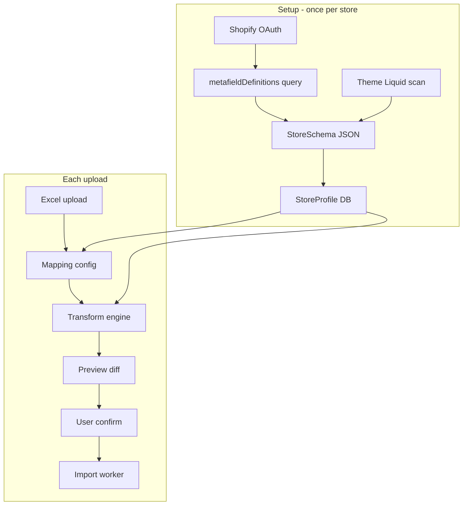

# Shopify Product Upload App — Complete Standalone Agent Specification

**Version:** 1.0  
**Last updated:** 2026-08-03  
**Self-contained:** This document is the **only file** an agent needs. No other repo, doc, or codebase access required.

---

## Table of contents

1. [What you are building](#1-what-you-are-building)
2. [Problem statement](#2-problem-statement)
3. [Core principles](#3-core-principles)
4. [End-to-end user flow](#4-end-to-end-user-flow)
5. [System architecture](#5-system-architecture)
6. [Import pipeline order](#6-import-pipeline-order)
7. [Schema discovery](#7-schema-discovery)
8. [Data models](#8-data-models)
9. [Transform engine](#9-transform-engine)
10. [Merge strategies on update](#10-merge-strategies-on-update)
11. [Editable system prompt](#11-editable-system-prompt)
12. [Preview and import session](#12-preview-and-import-session)
13. [Shopify GraphQL reference](#13-shopify-graphql-reference)
14. [Metafield value serialization](#14-metafield-value-serialization)
15. [Reference store example (Arthenic)](#15-reference-store-example-arthenic)
16. [JSON metafield schemas](#16-json-metafield-schemas)
17. [Default configs to ship](#17-default-configs-to-ship)
18. [App project structure](#18-app-project-structure)
19. [Database schema](#19-database-schema)
20. [API routes](#20-api-routes)
21. [Implementation phases](#21-implementation-phases)
22. [Agent rules](#22-agent-rules)
23. [Testing checklist](#23-testing-checklist)
24. [Security](#24-security)
25. [Error codes](#25-error-codes)

---

## 1. What you are building

A **Shopify embedded admin app** that lets merchants:

1. Install on their store (OAuth).
2. **Discover** product metafields from Shopify Admin + their theme Liquid code.
3. Edit a **system prompt** that helps map Excel columns → Shopify fields.
4. Upload an **Excel file** with arbitrary column names.
5. See a **preview** (create/update/skip, field diffs, validation errors).
6. Click **Import** to write products + metafields to Shopify.
7. Save a **store profile** (schema + mapping + policies) for repeat uploads.

The app generalizes a pattern proven on artisan marketplace stores: Excel is the merchant's source of truth for copy and prices; Shopify holds images/SKUs; complex metafields (lists, JSON) go through Admin GraphQL, not CSV import.

---

## 2. Problem statement

### Why not Shopify CSV import alone?

Shopify's standard product CSV import **does not reliably support**:

- `list.single_line_text_field` (accordion rows, filter lists)
- `json` metafields (maker/process/heritage story blocks)

Title, body HTML, price, and simple text metafields may work via CSV. **List and JSON metafields must use `metafieldsSet` GraphQL.**

### Why not one script per store?

Each store has:

- Different Excel column names
- Different theme metafield keys
- Different parsing rules (e.g. `K: Label V: Value` accordion format)
- Different handle overrides and frozen-field policies

Hardcoding per store does not scale. Solution:

- **Discover** schema automatically
- **Configure** mapping via JSON + editable AI prompt
- **Execute** via a fixed transform engine (AI outputs config, not code)

---

## 3. Core principles

| Rule | Reason |
|------|--------|
| AI outputs **JSON mapping config** only | Never `eval()` / `exec()` generated code |
| Transform engine is a **closed registry** | Predictable, testable, safe |
| Preview and import share **same payload builder** | What you preview is what you import |
| List/JSON metafields → **GraphQL only** | CSV path is unreliable |
| Updates respect **frozen fields** | Images, SKU, inventory stay untouched |
| Import requires **explicit confirm** | No silent writes |
| Per-store **profile** persisted | Repeat uploads without re-discovery |

---

## 4. End-to-end user flow

```
Install app
  → OAuth + save offline token
  → Run schema discovery (API + theme scan)
  → Seed default system prompt + import policy
  → Merchant reviews/edits prompt on Setup screen

New import:
  → Upload Excel (.xlsx)
  → App shows headers + 3 sample rows
  → Merchant clicks "Suggest mapping" (LLM) OR maps columns manually
  → Merchant saves mapping config
  → App runs transform engine → ProductDraft per row
  → App fetches live Shopify products for diff baseline
  → Preview grid: create / update / skip / error per row
  → Merchant reviews diffs
  → Merchant clicks Import (disabled if any errors)
  → Background job: create → update → metafields
  → Report page with per-handle success/failure + resume support
```

---

## 5. System architecture



### Components

| Component | Input | Output |
|-----------|-------|--------|
| Schema Discovery | Shop token, theme files | `StoreSchema` |
| Mapping AI | Prompt + schema + Excel sample | `MappingConfig` JSON |
| Transform Engine | Excel rows + mapping + policy | `ProductDraft[]` |
| Preview Service | Drafts + Shopify baseline | Diff objects |
| Import Worker | Confirmed drafts | Shopify API writes + report |

### Recommended stack

| Layer | Technology |
|-------|------------|
| App | Shopify Remix template |
| UI | Polaris |
| DB | Prisma + PostgreSQL (SQLite ok for dev) |
| Excel | SheetJS (`xlsx`) or pandas in Python worker |
| Jobs | BullMQ / Inngest / Remix background job |
| Files | S3, R2, or local disk |

### OAuth scopes

```
read_products
write_products
read_themes
```

---

## 6. Import pipeline order

**Mandatory order.** Do not upload metafields before the product exists.

```
Step 1: CREATE new products     (handles not in store)
Step 2: UPDATE existing products (title, body, price, template, tags)
Step 3: UPLOAD scalar metafields (text, single-line lists)
Step 4: UPLOAD JSON metafields   (story blocks — may be built from prose in step 3's transform pass)
Step 5: WRITE import report      (per-handle status, errors, resume cursor)
```

### Create vs update decision

```
IF match_strategy finds existing product by handle/sku/title:
  action = "update"
ELSE IF import_policy.create_missing:
  action = "create"
ELSE:
  action = "skip" + error HANDLE_NOT_FOUND
```

### Baseline for updates

Fetch existing product via GraphQL (or cached export CSV uploaded by merchant):

- Match by `handle` (default), `sku`, or normalized `title`
- Load current metafield values for merge strategies
- Never overwrite fields in `import_policy.frozen_fields`

---

## 7. Schema discovery

Run on: install, theme publish, manual "Refresh schema" button.

### 7.1 Shopify Admin API (authoritative types)

```graphql
query ProductMetafieldDefinitions($cursor: String) {
  metafieldDefinitions(first: 100, after: $cursor, ownerType: PRODUCT) {
    pageInfo {
      hasNextPage
      endCursor
    }
    edges {
      node {
        id
        namespace
        key
        name
        description
        type { name }
        validations { name value }
      }
    }
  }
}
```

Paginate until `hasNextPage` is false.

### 7.2 Theme scan (what storefront reads)

Regex over Liquid theme files:

```regex
product\.metafields\.([a-zA-Z0-9_]+)\.([a-zA-Z0-9_]+)
pdp_product\.metafields\.([a-zA-Z0-9_]+)\.([a-zA-Z0-9_]+)
```

**Scan these paths:**

- `snippets/*.liquid` (especially `pdp-*.liquid`, `pdp-content-resolve.liquid`)
- `sections/main-product*.liquid`
- `templates/product.*.json` (for `template_suffix` list)

**Theme API query (no Git required):**

```graphql
query ThemeFiles($themeId: ID!, $filenames: [String!]!) {
  theme(id: $themeId) {
    files(first: 50, filenames: $filenames) {
      nodes {
        filename
        body { content }
      }
    }
  }
}
```

Paginate `theme.files` with filters on `snippets/`, `sections/`, `templates/product`.

### 7.3 Parse hints (format expectations)

Assign `parse_hint` per metafield based on type + theme context:

| `parse_hint` | Meaning | Typical transform |
|--------------|---------|-------------------|
| `plain_text` | String as-is | `clean_text` |
| `paragraphs` | Split on blank lines | `html_paragraphs` |
| `lines` | One item per line | `lines_to_list` |
| `comma_list` | Split `,` `;` newline | `comma_to_list` |
| `kv_lines` | `K: {label} V: {value}` per line | `kv_lines` |
| `impact_stats` | `V: {stat} K: {label}` per line | `impact_stats` |
| `faq_pipe` | `Question \| Answer` per line | `faq_columns` |
| `json_object` | Structured JSON | `story_*_json` transforms |
| `html_body` | Prose → `<p>` tags | `html_paragraphs` |

### 7.4 Merge rules

For each `(namespace, key)`:

1. **API + theme** → `required_for_storefront: true`, use API type
2. **Theme only** → `required_for_storefront: true`, `shopify_type: "unknown"` (warn merchant)
3. **API only** → `required_for_storefront: false`, still mappable
4. Collect **aliases** when theme checks multiple keys (e.g. `product_maker_st` OR `product_maker_story`)

### 7.5 Shopify type → internal `value_kind`

| Shopify `type.name` | `value_kind` |
|---------------------|--------------|
| `single_line_text_field` | `string` |
| `multi_line_text_field` | `text` |
| `list.single_line_text_field` | `string_list` |
| `json` | `json` |
| `file_reference` | `file` |
| `number_integer` | `integer` |
| `number_decimal` | `decimal` |
| `boolean` | `boolean` |
| `product_reference` | `product_ref` |
| `list.product_reference` | `product_ref_list` |

### 7.6 StoreSchema output example

```json
{
  "schema_version": 1,
  "shop": "example.myshopify.com",
  "discovered_at": "2026-08-03T12:00:00Z",
  "product_templates": ["paintings", "ethnic-wear", "jewellery", "sculpture"],
  "metafields": [
    {
      "namespace": "custom",
      "key": "product_details",
      "shopify_type": "list.single_line_text_field",
      "value_kind": "string_list",
      "parse_hint": "kv_lines",
      "name": "Product details",
      "required_for_storefront": true,
      "in_theme": true,
      "theme_files": ["snippets/pdp-accordions.liquid"],
      "aliases": []
    }
  ]
}
```

---

## 8. Data models

### 8.1 StoreProfile

```typescript
interface StoreProfile {
  id: string;
  shop: string;
  schema: StoreSchema;
  system_prompt: string;
  mapping_config: MappingConfig;
  import_policy: ImportPolicy;
  created_at: string;
  updated_at: string;
}
```

### 8.2 ImportPolicy

```typescript
interface ImportPolicy {
  frozen_fields: string[];
  sale_price_multiplier?: number;
  compare_at_from_list_price: boolean;
  default_vendor?: string;
  default_status: "ACTIVE" | "DRAFT";
  match_strategy: "handle" | "sku" | "title";
  create_missing: boolean;
  update_existing: boolean;
  placeholder_values: string[];
}
```

**Default `frozen_fields`** (safe baseline for update imports):

```json
[
  "Image Src",
  "Image Position",
  "Image Alt Text",
  "Variant Image",
  "Variant SKU",
  "Variant Grams",
  "Variant Inventory Tracker",
  "Variant Inventory Qty",
  "Variant Inventory Policy",
  "Variant Fulfillment Service",
  "Variant Barcode",
  "Variant Requires Shipping",
  "Variant Taxable",
  "Variant Weight Unit",
  "Variant Tax Code",
  "Cost per item",
  "Product Category",
  "Published",
  "Vendor",
  "Gift Card",
  "Status",
  "Option1 Name",
  "Option1 Value",
  "Option2 Name",
  "Option2 Value",
  "Option3 Name",
  "Option3 Value",
  "SEO Title",
  "SEO Description"
]
```

**Default `placeholder_values`** (treat cell as empty):

```json
["common", "nan", "none", "as per the pictures", "same questions as mentioned in word"]
```

### 8.3 MappingConfig

```typescript
interface MappingConfig {
  excel: {
    sheet_name?: string;
    header_row: number;
    category_column?: string;
  };
  column_map: Record<string, ColumnMapping>;
  handle_overrides: Record<string, string>;
  template_map: Record<string, string>;
}

interface ColumnMapping {
  target:
    | "title"
    | "body_html"
    | "handle"
    | "template_suffix"
    | "variant.price"
    | "variant.compare_at_price"
    | "variant.sku"
    | "tags"
    | "metafield"
    | "ignore";
  namespace?: string;
  key?: string;
  transform: TransformId;
  transform_params?: Record<string, unknown>;
  merge_strategy?: "replace" | "merge_kv" | "merge_text" | "skip_if_empty";
}
```

### 8.4 ProductDraft (engine output)

```typescript
interface ProductDraft {
  handle: string;
  action: "create" | "update" | "skip";
  title?: string;
  body_html?: string;
  template_suffix?: string;
  tags?: string[];
  variants: Array<{
    sku?: string;
    price?: string;
    compare_at_price?: string;
  }>;
  metafields: Array<{
    namespace: string;
    key: string;
    type: string;
    value: unknown;
  }>;
  warnings: string[];
  errors: string[];
}
```

**Engine rules:**

1. One Excel row → one `ProductDraft`
2. `errors.length > 0` → row blocked from import
3. Engine is **pure** (no network calls)
4. Preview and import worker call the same `buildImportPayloads(sessionId)`

---

## 9. Transform engine

AI picks transform IDs. App executes a **closed registry**.

### 9.1 Transform registry

| Transform ID | Input | Output | Description |
|--------------|-------|--------|-------------|
| `identity` | any | same | Pass-through |
| `clean_text` | any | string | Normalize whitespace, unicode, quotes |
| `skip_placeholder` | string | string or empty | Empty if placeholder value |
| `slugify` | string | handle | Lowercase, non-alnum → `-` |
| `html_paragraphs` | string | HTML | Split `\n\n` → `<p>` tags |
| `lines_to_list` | string | string[] | Split on newlines/bullets |
| `comma_to_list` | string | string[] | Split `,` `;` newline, dedupe |
| `kv_lines` | string | string[] | Parse/build `K: x V: y` lines |
| `impact_stats` | string | string[] | Extract `V: 72% K: label` lines |
| `impact_note` | string | string | Long paragraph from impact prose |
| `sale_from_list` | number | `{price, compare_at}` | Sale = list × multiplier, ceiling |
| `faq_columns` | row cells | string[] | `Question \| Answer` per FAQ column |
| `story_maker_json` | prose | object | Maker story JSON |
| `story_process_json` | prose | object | Process story JSON |
| `story_heritage_json` | prose | object | Heritage story JSON |
| `story_styling_json` | prose | object | Styling cards JSON |
| `dimensions_block` | string | `{measurements, highlight, note}` | Parse dimension prose |

### 9.2 Algorithm: `clean_text`

```
function clean_text(val):
  if val is null/NaN: return ""
  text = trim(string(val))
  text = normalize newlines to \n
  text = unicode NFKC normalize
  text = replace smart quotes/dashes with ASCII equivalents
  text = collapse 3+ newlines to 2
  return trim(text)
```

### 9.3 Algorithm: `is_placeholder`

```
PLACEHOLDERS = import_policy.placeholder_values (lowercased)

function is_placeholder(val):
  return clean_text(val).toLowerCase() in PLACEHOLDERS
```

### 9.4 Algorithm: `slugify`

```
function slugify(text):
  text = clean_text(text).toLowerCase()
  text = replace non [a-z0-9] runs with "-"
  return trim(text, "-")
```

### 9.5 Algorithm: `kv_lines`

**Build** (Excel pairs → list items):

```
function kv_lines(pairs):
  rows = []
  for (key, value) in pairs:
    key, value = clean_text(key), clean_text(value)
    if key and value and not is_placeholder(value):
      rows.append("K: " + key + " V: " + value)
  return rows  // string array for list metafield
```

**Parse** (for merge):

```
function parse_kv_metafield(text):
  out = {}
  for line in clean_text(text).split("\n"):
    if line starts with "K: " and contains " V: ":
      key, value = split after "K: " on " V: "
      out[key.strip()] = value.strip()
  return out

function format_kv_metafield(pairs):
  return join "\n" of "K: {k} V: {v}" for each pair
```

### 9.6 Algorithm: `sale_from_list`

```
function sale_from_list(list_price_raw, multiplier = 0.95):
  text = clean_text(list_price_raw)
  if empty or placeholder: return { price: "", compare_at: "" }
  list_price = decimal(text with commas removed)
  if list_price <= 0: return { price: "", compare_at: "" }
  sale_price = list_price * multiplier
  return {
    price: ceil_to_integer_string(sale_price),
    compare_at: ceil_to_integer_string(list_price)
  }
```

### 9.7 Algorithm: `impact_stats`

Extract stats from freeform artisan impact prose:

```
function impact_stats(text):
  rows = []
  pct = regex find (\d{1,3})%
  days = regex find (\d{1,2}[-–]\d{1,2}|\d{1,2}) days?

  if pct found:
    label = "of this purchase goes directly to the artisan family"
    if "community" in text.lower(): label = "... artisan community"
    rows.append("V: {pct}% K: {label}")

  if days found:
    label = context-dependent (stitching / painting / setting / hand-work)
    rows.append("V: {days} days K: {label}")

  return rows as string array
```

Stored format per line: `V: 72% K: of this purchase goes directly to the artisan family`

### 9.8 Algorithm: `lines_to_list`

```
function lines_to_list(text):
  chunks = split on newlines and bullet chars
  for each chunk:
    strip leading "-–— "
    if non-empty and not placeholder: append
  return array
```

### 9.9 Algorithm: `comma_to_list`

```
function comma_to_list(text):
  parts = split on [,;\n]
  dedupe while preserving order
  return array of non-empty stripped strings
```

### 9.10 Algorithm: `story_maker_json` (prose → JSON)

**Input:** Multi-paragraph Excel cell (artist/maker bio).

**Steps:**

1. `first_line, rest = split on first newline`
2. Parse role/name: `The Artist – Neeraj Bhanawat` → role + name via regex `^(The\s+(Artist|Weaver|Maker|Craftsperson))\s*[–\-:]\s*(.+)$`
3. Split rest into paragraphs
4. Extract quote block if trailing `"quote" — cite` pattern
5. Build object:

```json
{
  "heading_html": "optional from separate column or generated",
  "eyebrow": "The artist | The maker | The Weaver | The Craftsperson",
  "name": "Person Name",
  "intro_paragraphs": ["..."],
  "quote": { "text": "...", "cite": "— Name, Place" },
  "closing_paragraphs": ["..."],
  "stats": [{ "value": "35 yrs", "label": "Experience" }],
  "meta": ["Location line", "Award line"]
}
```

6. Drop empty keys before upload.

### 9.11 Algorithm: `story_process_json` (prose → JSON)

**Input:** Process description — may be numbered steps, bullet-separated, or newline-separated.

**Step resolution order:**

1. Split on `•` bullets if multiple parts
2. Else split on newlines (fix merged words like `boxPainting` → `box\nPainting`)
3. Else parse inline `1. Step one. 2. Step two.`
4. Each step → `{ "title": "...", "description": "..." }`

**Output shape:**

```json
{
  "eyebrow": "optional",
  "heading_html": "Title with optional <br>",
  "description": "Intro paragraph",
  "video_tabs": ["Tab 1", "Tab 2"],
  "video_caption": "optional",
  "steps": [{ "title": "...", "description": "..." }]
}
```

### 9.12 Algorithm: `story_heritage_json` (prose → JSON)

**Output shape:**

```json
{
  "eyebrow": "optional",
  "heading_html": "...",
  "paragraphs": ["..."],
  "stat_line": "optional single line",
  "annotations": [{ "label": "...", "description": "..." }],
  "fabric_cards": [{ "title": "...", "description": "..." }]
}
```

For ethnic wear: split sentences into 2–3 `fabric_cards` with titles like "Fabric base", "Texture & motifs", "Wear & occasion".

---

## 10. Merge strategies on update

When `action === "update"` and baseline product exists:

| Strategy | Behavior |
|----------|----------|
| `replace` | New value replaces old (title, body) |
| `merge_kv` | Parse both as `K: V:` dicts; new keys overwrite; old keys kept |
| `merge_text` | Replace only if new non-empty and not placeholder |
| `skip_if_empty` | Keep old if new is empty |

### merge_kv pseudocode

```
function merge_kv(old, new):
  if new is empty: return old
  old_pairs = parse_kv_metafield(old)
  new_pairs = parse_kv_metafield(new)
  if new_pairs empty: return old
  merged = copy(old_pairs)
  for (k, v) in new_pairs:
    if v and not is_placeholder(v): merged[k] = v
  return format_kv_metafield(merged)
```

### merge impact stats

On update, **replace entire** impact stats list if new stats provided (do not merge line-by-line).

---

## 11. Editable system prompt

Stored in `StoreProfile.system_prompt`. Merchant edits in Setup UI. "Regenerate mapping" sends prompt + context to LLM.

### 11.1 LLM input payload

```json
{
  "store_schema": { },
  "excel_headers": ["Product Name", "MRP", "Details"],
  "excel_sample_rows": [
    ["Handwoven Saree", "12000", "K: Fabric V: Silk"],
    ["Miniature Painting", "8500", "K: Tradition V: Pattachitra"]
  ],
  "import_policy": { },
  "existing_mapping_config": { }
}
```

### 11.2 Required LLM output (JSON only, no markdown fences)

```json
{
  "column_map": {
    "Product Name": { "target": "title", "transform": "clean_text" },
    "MRP": {
      "target": "variant.price",
      "transform": "sale_from_list",
      "transform_params": { "multiplier": 0.95 }
    },
    "Details": {
      "target": "metafield",
      "namespace": "custom",
      "key": "product_details",
      "transform": "kv_lines",
      "merge_strategy": "merge_kv"
    }
  },
  "handle_strategy": {
    "primary": "slugify",
    "source_column": "Product Name",
    "overrides": {}
  },
  "template_map": {
    "painting": "paintings",
    "ethnic": "ethnic-wear",
    "jewellery": "jewellery",
    "decor": "sculpture"
  },
  "notes": ["Mapped FAQ columns FAQ 1–10 with faq_columns transform"]
}
```

### 11.3 Default system prompt (copy verbatim, seed on install)

```text
You are a Shopify catalog mapping assistant.

Given:
- store_schema: metafields the theme and Admin expect (types + parse_hint)
- excel_headers and sample rows
- import_policy

Produce ONLY valid JSON matching the required output shape. No markdown fences. No commentary outside JSON.

Rules:
1. Map each Excel column to at most one target.
2. Use transform IDs from this allowed list only:
   identity, clean_text, skip_placeholder, slugify, html_paragraphs,
   lines_to_list, comma_to_list, kv_lines, impact_stats, impact_note,
   sale_from_list, faq_columns, story_maker_json, story_process_json,
   story_heritage_json, story_styling_json, dimensions_block
3. For metafields, namespace and key MUST exist in store_schema OR be noted in "notes".
4. Match parse_hint when choosing transform:
   - kv_lines hint → kv_lines transform
   - json_object hint → appropriate story_*_json transform
   - comma_list hint → comma_to_list
5. Do not map columns to frozen_fields from import_policy.
6. Prefer handle match via slugify on title column; put exceptions in handle_strategy.overrides.
7. List metafield transforms must output string arrays.
8. JSON metafield transforms must output objects (not strings).
9. If unsure, set target to "ignore" and explain in notes.

Store schema:
{{STORE_SCHEMA_JSON}}

Import policy:
{{IMPORT_POLICY_JSON}}
```

Replace `{{STORE_SCHEMA_JSON}}` and `{{IMPORT_POLICY_JSON}}` at runtime.

### 11.4 Post-LLM validation (reject if any fail)

- JSON parse error
- Unknown `transform` id
- Duplicate column targets
- `target: metafield` without namespace/key
- Type mismatch (e.g. `string_list` transform returns string)

---

## 12. Preview and import session

### 12.1 Session states

```
draft → mapping_ready → preview_ready → confirmed → importing → completed | failed
```

| State | Description |
|-------|-------------|
| `draft` | Excel uploaded |
| `mapping_ready` | MappingConfig saved |
| `preview_ready` | Transforms run, diffs computed |
| `confirmed` | User clicked Import |
| `importing` | Worker running |
| `completed` / `failed` | Terminal |

### 12.2 Preview UI (per row)

| Field | Show |
|-------|------|
| Status | create / update / skip / error |
| Handle | proposed handle |
| Title | `old → new` |
| Price | `old → new` |
| Template | `old → new` |
| Metafields | expandable per-key diff |
| Warnings | non-blocking |
| Errors | blocking |

**Summary:** `12 create, 45 update, 3 skip, 2 errors`  
**Import button:** disabled when `errors > 0`

### 12.3 Import report format

```json
{
  "session_id": "...",
  "started_at": "...",
  "completed_at": "...",
  "summary": { "created": 12, "updated": 45, "failed": 2, "skipped": 3 },
  "handles": [
    {
      "handle": "handwoven-saree",
      "status": "updated",
      "metafields_set": 14,
      "errors": []
    },
    {
      "handle": "bad-row",
      "status": "failed",
      "errors": ["INVALID_JSON_METAFIELD: product_maker_story"]
    }
  ],
  "resume_from_handle": "bad-row"
}
```

Support **resume**: skip handles with `status: "updated"` or `"created"` already in report.

---

## 13. Shopify GraphQL reference

**API version:** Use a current stable version (e.g. `2025-01`). Pin in config.

### 13.1 Fetch product by handle (baseline)

```graphql
query ProductByHandle($handle: String!) {
  productByHandle(handle: $handle) {
    id
    title
    handle
    descriptionHtml
    templateSuffix
    tags
    variants(first: 10) {
      nodes {
        id
        sku
        price
        compareAtPrice
      }
    }
    metafields(first: 50) {
      nodes {
        namespace
        key
        type
        value
        jsonValue
      }
    }
  }
}
```

### 13.2 Create product

```graphql
mutation productCreate($input: ProductInput!) {
  productCreate(input: $input) {
    product {
      id
      handle
    }
    userErrors {
      field
      message
    }
  }
}
```

**ProductInput fields used:**

- `title`, `handle`, `descriptionHtml`, `productType`, `vendor`, `tags`
- `templateSuffix` (e.g. `paintings` for template `product.paintings`)
- `status`: `ACTIVE` or `DRAFT`
- `variants`: `[{ price, compareAtPrice, sku }]`

### 13.3 Update product

```graphql
mutation productUpdate($input: ProductInput!) {
  productUpdate(input: $input) {
    product {
      id
      handle
    }
    userErrors {
      field
      message
    }
  }
}
```

`input.id` = product GID. Only send changed fields.

### 13.4 Set metafields

```graphql
mutation metafieldsSet($metafields: [MetafieldsSetInput!]!) {
  metafieldsSet(metafields: $metafields) {
    metafields {
      id
      namespace
      key
    }
    userErrors {
      field
      message
    }
  }
}
```

**MetafieldsSetInput:**

```json
{
  "ownerId": "gid://shopify/Product/123",
  "namespace": "custom",
  "key": "product_details",
  "type": "list.single_line_text_field",
  "value": "[\"K: Fabric V: Silk\",\"K: Region V: Varanasi\"]"
}
```

### 13.5 Rate limits

- Batch metafields (verify current limit — often 25 per call)
- Exponential backoff on HTTP 429
- Persist progress per handle for resume

---

## 14. Metafield value serialization

| Shopify type | `value` field in metafieldsSet |
|--------------|-------------------------------|
| `single_line_text_field` | Plain string |
| `multi_line_text_field` | Plain string with `\n` |
| `list.single_line_text_field` | **JSON string** of array: `"[\"line1\",\"line2\"]"` |
| `json` | **JSON string** of object: `"{\"heading_html\":\"...\"}"` |
| `number_integer` | Stringified integer `"42"` |
| `number_decimal` | Stringified decimal `"19.99"` |
| `boolean` | `"true"` or `"false"` |

### Example: list metafield payload

```json
{
  "ownerId": "gid://shopify/Product/123456789",
  "namespace": "custom",
  "key": "product_details",
  "type": "list.single_line_text_field",
  "value": "[\"K: Tradition V: Pattachitra\",\"K: Region V: Odisha\"]"
}
```

### Example: JSON metafield payload

```json
{
  "ownerId": "gid://shopify/Product/123456789",
  "namespace": "custom",
  "key": "product_maker_story",
  "type": "json",
  "value": "{\"heading_html\":\"A painting that begins with the earth\",\"intro_paragraphs\":[\"...\"]}"
}
```

**Validate:** `JSON.parse(value)` must succeed before API call for `json` and list types.

---

## 15. Reference store example (Arthenic)

Use as a **test profile**, not hardcoded in app core. Namespace: `custom`. All PDP templates share the same metafield keys.

### 15.1 Product templates

| Category | `template_suffix` | Shopify template |
|----------|-------------------|------------------|
| Paintings | `paintings` | `product.paintings` |
| Ethnic wear | `ethnic-wear` | `product.ethnic-wear` |
| Jewellery | `jewellery` | `product.jewellery` |
| Sculpture / décor | `sculpture` | `product.sculpture` |

### 15.2 Hero metafields

| Key | Shopify type | Example value |
|-----|--------------|---------------|
| `pdp_category_tag` | single_line_text_field | `Katan Silk · Handwoven · Varanasi` |
| `pdp_subtitle` | multi_line_text_field | Short line under title |
| `pdp_scarcity_message` | single_line_text_field | `Handwoven · Only 4 remaining` |

### 15.3 Accordion metafields (list.single_line_text_field)

| Key | Line format |
|-----|-------------|
| `product_details` | `K: {label} V: {value}` |
| `product_measurements` | `K: {label} V: {measurement}` e.g. `K: Width V: 24 in` |
| `product_whats_included` | One bullet per line; optional `Title — description` |
| `product_impact_stats` | `V: {stat} K: {label}` e.g. `V: 72% K: of this purchase goes directly to the artisan family` |
| `product_care_instructions` | One care tip per line (plain text) |
| `product_faq` | `Question \| Answer` per line |

### 15.4 Accordion text metafields (multi_line_text_field)

| Key | Purpose |
|-----|---------|
| `product_measurement_highlight` | Wall/scale reference box |
| `product_measurement_note` | Note under measurement cards |
| `product_impact_note` | Paragraph under impact stat cards |

### 15.5 Story JSON metafields

| Key | Type | Notes |
|-----|------|-------|
| `product_maker_story` | json | Alias: `product_maker_st` (theme may check both) |
| `product_process_story` | json | Steps + optional video tabs |
| `product_heritage_story` | json | Paragraphs + annotations / fabric cards |
| `pdp_styling_story` | json | Styling guide cards |

### 15.6 Optional file metafields

| Key | Type |
|-----|------|
| `product_maker_portrait` | file_reference (image) |
| `product_process_video` | file_reference (video) |

### 15.7 Collection filter metafields

| Key | Type |
|-----|------|
| `filter_color` | single_line_text_field |
| `filter_fabric` | single_line_text_field |
| `filter_material` | single_line_text_field |
| `filter_subject` | single_line_text_field |
| `filter_region` | single_line_text_field |
| `filter_style` | single_line_text_field |
| `filter_tradition` | single_line_text_field |
| `filter_occasion` | list.single_line_text_field |
| `filter_product_type` | single_line_text_field |
| `filter_jewelry_type` | single_line_text_field |

### 15.8 Optional bundle metafield

| Key | Type | Purpose |
|-----|------|---------|
| `pdp_content` | json | Single JSON bundle overriding individual fields when set |

### 15.9 Arthenic import policy

```json
{
  "frozen_fields": ["Image Src", "Variant SKU", "Variant Inventory Qty", "..."],
  "sale_price_multiplier": 0.95,
  "compare_at_from_list_price": true,
  "match_strategy": "handle",
  "create_missing": true,
  "update_existing": true,
  "default_status": "ACTIVE",
  "placeholder_values": ["common", "nan", "none", "as per the pictures"]
}
```

Sale price = `ceil(list_price × 0.95)`; compare-at = `ceil(list_price)`.

### 15.10 Theme requirement

Each metafield definition must have **Storefront → Read** enabled or Liquid on the live PDP cannot read it.

---

## 16. JSON metafield schemas

### 16.1 product_maker_story

```json
{
  "eyebrow": "The artist",
  "heading_html": "A painting that begins with the earth itself",
  "name": "Mala Devi Maharana",
  "intro_paragraphs": ["Paragraph one.", "Paragraph two."],
  "quote": {
    "text": "Every colour I use has a memory.",
    "cite": "— Mala Devi Maharana, Raghurajpur, Odisha"
  },
  "closing_paragraphs": ["Final paragraph."],
  "stats": [
    { "value": "35 yrs", "label": "Painting experience" },
    { "value": "5th gen", "label": "Family tradition" }
  ],
  "meta": [
    "Raghurajpur Heritage Craft Village, Puri, Odisha",
    "National Award for Handicrafts, 2019"
  ]
}
```

Use `intro_paragraphs` + `quote` + `closing_paragraphs` for correct order. Legacy `paragraphs` = all text before quote.

### 16.2 product_process_story

```json
{
  "eyebrow": "How it's made",
  "heading_html": "A two-thousand-year tradition,<br>one canvas at a time",
  "description": "Intro paragraph about the process.",
  "video_tabs": ["Canvas preparation", "Pigment grinding", "Painting in progress"],
  "video_caption": "Canvas preparation · tamarind paste and chalk ground",
  "steps": [
    {
      "title": "Canvas preparation (Patta)",
      "description": "Cotton cloth is layered with tamarind paste and chalk."
    },
    {
      "title": "Pigment preparation",
      "description": "Indigo, vermilion, and conch-shell white are ground on stone."
    }
  ]
}
```

`video_tabs` and `video_caption` only matter when `product_process_video` file is uploaded.

### 16.3 product_heritage_story

```json
{
  "eyebrow": "Understanding the painting",
  "heading_html": "Radha in the Rain — the Sravana mood",
  "paragraphs": [
    "First heritage paragraph.",
    "Second heritage paragraph."
  ],
  "stat_line": "Rasa: Vipralambha Sringara · Raga: Megh Malhar",
  "annotations": [
    {
      "label": "The upward gaze",
      "description": "Radha looks toward the sky."
    }
  ],
  "fabric_cards": [
    {
      "title": "Fabric base",
      "description": "Katan silk woven on a pit loom."
    }
  ]
}
```

`fabric_cards` used mainly for ethnic wear template.

### 16.4 pdp_styling_story

```json
{
  "cards": [
    {
      "tag": "Styling",
      "title": "Formal evening wear",
      "description": "Works beautifully for formal evening events."
    }
  ]
}
```

---

## 17. Default configs to ship

### 17.1 Reference MappingConfig (Arthenic-style)

```json
{
  "excel": { "header_row": 1 },
  "column_map": {
    "Product Name": { "target": "title", "transform": "clean_text" },
    "Product Description": { "target": "body_html", "transform": "html_paragraphs" },
    "List Price": {
      "target": "variant.price",
      "transform": "sale_from_list",
      "transform_params": { "multiplier": 0.95 }
    },
    "Product Details": {
      "target": "metafield",
      "namespace": "custom",
      "key": "product_details",
      "transform": "kv_lines",
      "merge_strategy": "merge_kv"
    },
    "Measurements": {
      "target": "metafield",
      "namespace": "custom",
      "key": "product_measurements",
      "transform": "kv_lines",
      "merge_strategy": "merge_kv"
    },
    "Artist Bio": {
      "target": "metafield",
      "namespace": "custom",
      "key": "product_maker_story",
      "transform": "story_maker_json"
    },
    "How It's Made": {
      "target": "metafield",
      "namespace": "custom",
      "key": "product_process_story",
      "transform": "story_process_json"
    },
    "Heritage": {
      "target": "metafield",
      "namespace": "custom",
      "key": "product_heritage_story",
      "transform": "story_heritage_json"
    }
  },
  "handle_strategy": {
    "primary": "slugify",
    "source_column": "Product Name",
    "overrides": {}
  },
  "template_map": {
    "painting": "paintings",
    "ethnic": "ethnic-wear",
    "jewellery": "jewellery",
    "decor": "sculpture"
  }
}
```

### 17.2 Default import policy (new stores)

```json
{
  "frozen_fields": [
    "Image Src", "Image Position", "Image Alt Text", "Variant Image",
    "Variant SKU", "Variant Inventory Qty", "Variant Inventory Policy",
    "SEO Title", "SEO Description"
  ],
  "compare_at_from_list_price": false,
  "match_strategy": "handle",
  "create_missing": true,
  "update_existing": true,
  "default_status": "DRAFT",
  "placeholder_values": ["nan", "none", "n/a", "tbd"]
}
```

---

## 18. App project structure

```
shopify-product-import/
├── app/
│   ├── routes/
│   │   ├── app._index.tsx
│   │   ├── app.setup.tsx
│   │   ├── app.import.new.tsx
│   │   ├── app.import.$id.mapping.tsx
│   │   ├── app.import.$id.preview.tsx
│   │   └── api.import-sessions.$.ts
│   ├── services/
│   │   ├── schema-discovery.server.ts
│   │   ├── transform-engine.server.ts
│   │   ├── transforms/
│   │   │   ├── registry.ts
│   │   │   ├── text.ts
│   │   │   ├── kv.ts
│   │   │   ├── pricing.ts
│   │   │   └── stories.ts
│   │   ├── preview.server.ts
│   │   ├── import-worker.server.ts
│   │   └── mapping-ai.server.ts
│   └── shopify.server.ts
├── prisma/
│   └── schema.prisma
├── prompts/
│   └── default-mapping-system.txt
└── profiles/
    └── arthenic.reference.json
```

---

## 19. Database schema

```prisma
model Shop {
  id             String          @id @default(cuid())
  shopDomain     String          @unique
  accessToken    String
  profile        StoreProfile?
  importSessions ImportSession[]
  createdAt      DateTime        @default(now())
  updatedAt      DateTime        @updatedAt
}

model StoreProfile {
  id            String   @id @default(cuid())
  shopId        String   @unique
  shop          Shop     @relation(fields: [shopId], references: [id])
  schemaJson    Json
  systemPrompt  String   @db.Text
  mappingConfig Json     @default("{}")
  importPolicy  Json
  schemaVersion Int      @default(1)
  updatedAt     DateTime @updatedAt
}

model ImportSession {
  id            String    @id @default(cuid())
  shopId        String
  shop          Shop      @relation(fields: [shopId], references: [id])
  status        String
  excelPath     String
  mappingConfig Json?
  previewJson   Json?
  reportJson    Json?
  createdAt     DateTime  @default(now())
  confirmedAt   DateTime?
}
```

---

## 20. API routes

| Method | Path | Purpose |
|--------|------|---------|
| POST | `/api/import-sessions` | Upload Excel, create session |
| GET | `/api/import-sessions/:id` | Session status |
| POST | `/api/import-sessions/:id/map` | Save MappingConfig |
| POST | `/api/import-sessions/:id/suggest-mapping` | LLM suggest mapping |
| POST | `/api/import-sessions/:id/preview` | Run engine + build diffs |
| GET | `/api/import-sessions/:id/preview` | Paginated preview rows |
| POST | `/api/import-sessions/:id/confirm` | Start import job |
| GET | `/api/import-sessions/:id/report` | Import report |
| POST | `/api/schema/refresh` | Re-run schema discovery |
| GET | `/api/profile` | Get StoreProfile |
| PUT | `/api/profile/prompt` | Update system prompt |
| PUT | `/api/profile/policy` | Update import policy |

---

## 21. Implementation phases

### Phase 1 — Schema + profile (no AI)

- [ ] Shopify Remix app + OAuth
- [ ] `metafieldDefinitions` pagination
- [ ] Theme Liquid scan
- [ ] Merge → StoreSchema
- [ ] StoreProfile CRUD + default import policy
- [ ] Manual column mapping UI

### Phase 2 — Transform engine + preview

- [ ] Implement all transforms from §9
- [ ] Excel upload + parse
- [ ] ProductDraft builder
- [ ] Shopify baseline fetch
- [ ] Preview diff UI
- [ ] Shared `buildImportPayloads()`

### Phase 3 — Import worker

- [ ] productCreate / productUpdate
- [ ] metafieldsSet with correct serialization (§14)
- [ ] Job queue + resume + report
- [ ] Confirm gate

### Phase 4 — AI mapping

- [ ] System prompt editor UI
- [ ] LLM → validated MappingConfig
- [ ] Regenerate mapping button

### Phase 5 — Reference profile validation

- [ ] Load `arthenic.reference.json`
- [ ] Run sample Excel through engine
- [ ] Verify list metafield lines and JSON shapes match §16

---

## 22. Agent rules

### Must do

1. Implement transforms as pure functions with unit tests
2. Validate JSON metafields before `metafieldsSet`
3. Use GraphQL for all list and JSON metafields
4. Show per-metafield diffs in preview
5. Block import when any row has errors
6. Support resume after partial failure
7. Version `StoreSchema.schema_version` on shape changes
8. Encrypt Shopify access tokens at rest

### Must not do

1. Execute AI-generated code
2. Overwrite frozen fields on update
3. Use CSV import for `list.*` or `json` metafields
4. Hardcode one store's handles in app core
5. Import without user confirmation
6. Assume fixed Excel column names

---

## 23. Testing checklist

### Unit tests — transforms

- [ ] `clean_text` normalizes unicode dashes and smart quotes
- [ ] `kv_lines` produces `K: Tradition V: Varanasi`
- [ ] `parse_kv_metafield` round-trips with `format_kv_metafield`
- [ ] `sale_from_list(10000, 0.95)` → price `9500`, compare `10000` (ceiling)
- [ ] `merge_kv` keeps old keys not in update
- [ ] `is_placeholder("common")` → true
- [ ] `story_maker_json` parses `The Artist – Name` first line
- [ ] `story_process_json` splits `1. Step one. 2. Step two.`

### Integration tests

- [ ] Schema discovery on mock Liquid returns `product_details`
- [ ] Preview: price-only change, metafields unchanged
- [ ] Preview: unknown handle + create_missing → action create
- [ ] Import: list metafield value is JSON-stringified array
- [ ] Import: resume skips completed handles
- [ ] Frozen SKU not changed on update

### Manual smoke test

1. Install app on dev store
2. Create metafield definitions matching §15
3. Upload 3-row Excel with one new + one existing product
4. Preview shows correct create/update
5. Import succeeds
6. Verify metafields in Admin + storefront PDP

---

## 24. Security

- Encrypt `accessToken` in database
- Max Excel size (e.g. 20 MB) and max rows (e.g. 5000)
- Scope import sessions to authenticated shop only
- Do not send access tokens to LLM
- Sanitize `body_html` if merchants are untrusted (optional)
- Rate-limit upload and import endpoints

---

## 25. Error codes

| Code | Merchant message |
|------|------------------|
| `SCHEMA_THEME_MISMATCH` | Theme uses `custom.foo` but no Admin definition exists. Create it in Settings → Custom data → Products. |
| `INVALID_JSON_METAFIELD` | Row `{handle}`: `{key}` is not valid JSON. |
| `TYPE_MISMATCH` | `{key}` expects a list; got plain text. |
| `HANDLE_NOT_FOUND` | Update requested but handle `{handle}` does not exist. |
| `FROZEN_FIELD` | Column maps to a frozen field (`{field}`) and cannot be updated. |
| `IMPORT_RATE_LIMIT` | Shopify rate limit hit. Import will retry automatically. |
| `MISSING_STOREFRONT_ACCESS` | Metafield `{key}` may not be visible on storefront. Enable Storefront → Read. |

---

## Appendix A — KV line format reference

Theme accordion snippets expect each list item as:

```
K: {Label} V: {Value}
```

Examples:

```
K: Tradition V: Traditional Indian Miniature Painting
K: Width V: 24 in
K: Height V: 36 in
V: 72% K: of this purchase goes directly to the artisan family
```

Impact stats reverse order: **value first**, then label.

---

## Appendix B — FAQ line format

```
What is the return policy? | 7-day return for unused items in original packaging.
How long does shipping take? | 5-7 business days within India.
```

---

## Appendix C — Handle override pattern

When `slugify(title)` produces wrong handle:

```json
{
  "handle_overrides": {
    "SKU-PAINT-001": "radha-in-the-rain",
    "Wine Boxes Painted": "wine-boxes-painted"
  }
}
```

Lookup order: explicit handle column → override by SKU → override by title → slugify(title).

---

## Appendix D — Agent quick start

1. Scaffold Shopify Remix app
2. Implement §7 schema discovery
3. Implement §9 transform registry (start with `clean_text`, `kv_lines`, `sale_from_list`)
4. Implement §12 preview with mock data
5. Implement §13 import worker for one metafield type
6. Expand transforms and metafield types incrementally
7. Add §11 AI mapping last

**This document is complete.** No external files required.

---

*End of specification v1.0*
